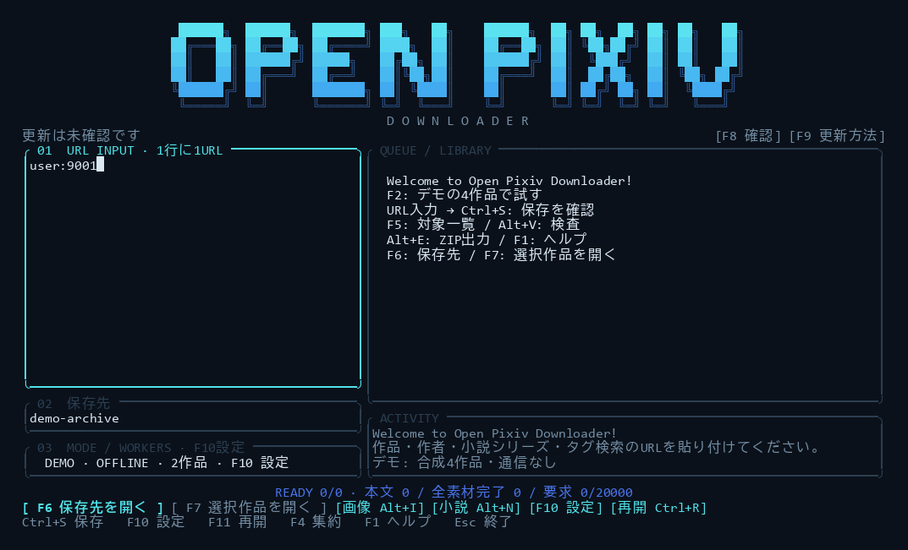
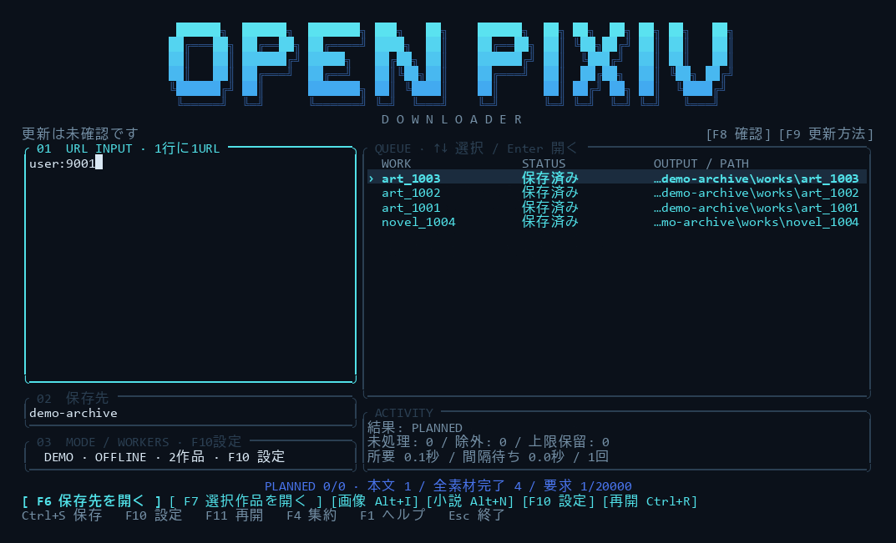
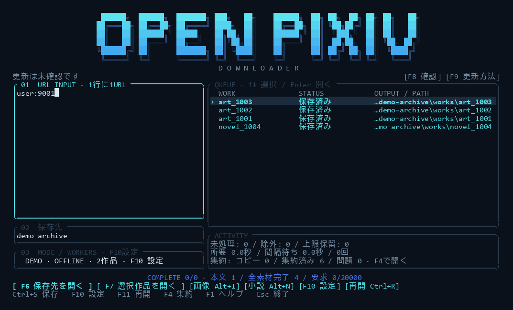
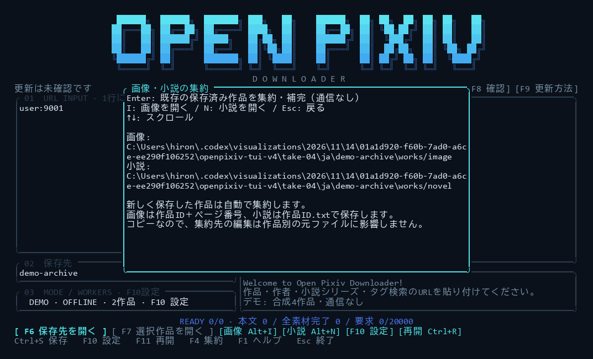

#  OpenPixiv

### 好きな作品を、まとめて手元に。

作者・タグ・複数URLから、イラストと小説をまとめて保存。対象を確認し、手元に残し、中断したら続きを再開。ひとつのターミナルで扱えます。

[English](README.md) · **日本語**

[LPを見る](https://openpixiv.pages.dev/) · [ダウンロード](#導入する) · [最初の保存](#最初の保存まで) · [FAQ](#faq) · [ドキュメント](docs/README.md)



*Windows版 v0.3.0-alpha.1の実TUI。準備済みの合成4作品で、一覧表示と再開を記録しています。実Pixivからの取得映像ではありません。*

## 導入する

**ダウンロード → 展開 → 実行ファイルがあるフォルダーでターミナルを開く。** 配布版の起動にRustやPythonは必要ありません。

| 環境 | ダウンロード | 起動 |
| --- | --- | --- |
| Windows x64 | [ZIPをダウンロード](https://github.com/ELRdn/Open-Pixiv-Downloader/releases/download/v0.3.0-alpha.2/opixiv-v0.3.0-alpha.2-windows-x86_64.zip) | PowerShellで `.\opixiv.exe` |
| Linux x64（glibc 2.39以降） | [tar.gzをダウンロード](https://github.com/ELRdn/Open-Pixiv-Downloader/releases/download/v0.3.0-alpha.2/opixiv-v0.3.0-alpha.2-linux-x86_64.tar.gz) | `./opixiv` |

[リリースノート・チェックサム](https://github.com/ELRdn/Open-Pixiv-Downloader/releases/tag/v0.3.0-alpha.2) · Windowsを中心に開発しているα版です。

<details>
<summary>Cargoで導入する・ほかの環境でビルドする</summary>

[Rust stable 1.89以降](https://www.rust-lang.org/tools/install)とGitを用意してください。WindowsではRustの案内に従い、Visual StudioのC++ビルド環境も導入します。

```sh
cargo install --git https://github.com/ELRdn/Open-Pixiv-Downloader.git --branch main --locked --force
opixiv
```

Rust版の実行にPythonは不要です。今回のリリースにmacOS用の実行ファイルはありません。

</details>

## 最初の保存まで

**まずは通信なしで試す：** `opixiv --no-update-check` で起動し、**F2 → Ctrl+S → Enter**。組み込みの架空4作品を `demo-archive` に保存します。Pixivへの接続や更新確認を行いません。ダウンロードしたWindows版は `.\opixiv.exe --no-update-check` で起動してください。

**日本語への切り替え：** 初期言語は英語です。**F10 → Tabで「Language」へ → ← / →で「日本語」→ Enter**。言語と設定は再起動後も引き継ぎます。

自分のアーカイブを作るときは、次の3ステップです。

1. **対象を入れる。** 作品・作者・小説シリーズ・タグ検索のURLを、1行に1件ずつ貼り付けます。**Tab**で保存先を選びます。
2. **一覧を確認する。** **F5**で対象を表示。画像などの媒体は保存しません。オンラインでは、この一覧確認にも通信が発生します。
3. **まとめて保存する。** **F11 → Enter**で確認した一覧を保存。**F6**で保存先、**F4**で画像・小説の集約先を確認できます。

確認を挟まず始めるなら **Ctrl+S → Enter**。オンラインで使う前に、[対象範囲と利用条件](#対象範囲と利用条件)を確認してください。

## 繰り返す操作を、ひとつの流れに

| やりたいこと | 操作 |
| --- | --- |
| 同じ作者の作品をまとめる | 作者URLを追加し、**F5**で一覧を確認 |
| 中断した続きから保存する | **F11** / **Ctrl+R**。保存済みを確認してスキップ |
| 保存したファイルを開く | **F6**で保存先、**F7**で選択作品 |
| 小説本文だけを保存する | **F10 → 保存モード → 本文のみ TXT → Enter** |
| 言語・並列数・通信設定を変える | **F10**。**Tab**で移動、**← / →**で切り替え、**Enter**で記憶 |
| 欠損や停止理由を調べる | **F3** |
| 保存済みを検査する・ZIPにする | **Alt+V** / **Alt+E** |
| 小説TXTを変換・復元する | **Alt+C** |
| 実行を止める・待機中に終了する | **Esc** / **Ctrl+C** |

すべてのキーはアプリ内の **F1**、細かな仕様は[使い方・技術リファレンス](docs/USAGE_JA.md)で確認できます。

<details>
<summary>一覧・再開・保存先の実録を見る</summary>

| 作者の作品一覧 | 保存済みから再開 | 保存先を確認 |
| --- | --- | --- |
| [](website/public/recordings/batch.gif) | [](website/public/recordings/resume.gif) | [](website/public/recordings/outputs.gif) |

画像を開くとGIFを再生します。すべてv0.3.0-alpha.1の実アプリと合成データを使っています。

</details>

## 小説TXTを変換・復元する

**Alt+C** でTXT変換を開きます。保存済み一覧でクリックするか、**Tab** で一覧へ移動し、**Space** で作品を選びます。**Shift+↑/↓** で範囲選択、**Ctrl+A** で全選択できます。一覧には現在の保存先の `novel/` と `works/novel/` にあるTXTが表示されます。

別の場所のTXTを変換するには、入力方法の欄で **←/→** を押して **フォルダー / TXT** を選びます。フォルダー指定ではサブフォルダーも対象です。範囲を空欄にすると全件、`2-10` と入力すると相対パス順の2〜10番を選びます。形式は **7z（高圧縮）**、**tar.zst（高速）**、**Parquet（データセット）** から選べます。**Enter** で対象を確認し、もう一度 **Enter** を押すと実行します。

**TXTへ復元** を選んで変換ファイルを指定すると、元のファイル名とバイト列を新しいフォルダーに復元できます。Parquetの復元はOpenPixivのTXTスキーマ（`relative_path`、バイナリの `content`、`sha256`）に対応します。変換と復元はオフラインで動作し、元ファイルは保持されます。

PPMd方式の `.7z` はOpenPixivか7-Zipで展開してください。Windows標準の `tar.exe` では、PPMdのソリッドアーカイブの展開に失敗することがあります。

## コマンドで使う

CLIは同じアーカイブを扱い、結果をJSONで返します。以下は通信しないデモです。

```sh
opixiv plan user:9001 --demo --all --out demo-archive
opixiv fetch user:9001 --demo --all --out demo-archive
opixiv verify demo-archive
opixiv collect demo-archive
opixiv pack demo-archive demo-export.zip
opixiv convert-txt demo-archive/works/novel --format 7z --out novels.7z
opixiv restore-txt novels.7z --out restored-novels
```

引数は `opixiv --help` / `opixiv fetch --help` で確認できます。ダウンロードしたWindows版は、展開先で `opixiv` を `.\opixiv.exe` に読み替えてください。

## FAQ

<details>
<summary><strong>ファイルはどこに保存される？</strong></summary>

標準モードは `archive/works/` に作品別の元データを保存し、画像を `archive/works/image/`、小説本文を `archive/works/novel/` に集約します。**F4**で場所を確認できます。本文専用モードでは `archive/novel/novel_<ID>.txt` に直接保存し、画像・HTML・作品別JSONを作りません。

</details>

<details>
<summary><strong>URLを入れ直さず再開できる？</strong></summary>

はい。同じ保存先を選び、**F11**または **Ctrl+R** を押してください。最新の保存対象一覧を使い、保存済みファイルを確認してスキップします。予算切れ・取消で止まった一覧列挙も続行できます。作者の新作などを追加する場合は、元のURLから一覧を取り直します。

</details>

<details>
<summary><strong>更新するには？</strong></summary>

起動中のツールを終了し、`opixiv update` を実行します。自己更新にはRust/CargoとGitが必要です。配布版だけで使う場合は、新版をダウンロード・展開して新しい実行ファイルを起動し、これまでの保存先を引き続き指定してください。**F8**で更新確認、**F9**で更新方法を表示できます。

</details>

<details>
<summary><strong>すべてのPixiv作品に対応している？</strong></summary>

オンラインでは匿名で閲覧でき、公開・全年齢と確認できる作品が対象です。イラスト・漫画・うごイラの元ZIPと時間情報・小説の保存に対応していますが、実サイトでの4形式すべての互換性は未検証です。本人セッションへの対応、作品の更新検出・旧版保持は未実装です。[検証状況](docs/STATUS_JA.md)も参照してください。

</details>

## 対象範囲と利用条件

OpenPixivは独立したMITライセンスのα版で、Pixiv公式サービスではありません。録画は合成データを使っています。Windows／LinuxのCIや実TUIの録画は、実サイトでの取得互換性・処理速度の確認とは別です。

オンラインで使う前に、作品の利用許可と[Pixivの利用条件](https://policies.pixiv.net/)を確認してください。公式ガイドラインはクローラー等による作品収集を禁止しており、この自動取得方式の適合を確認済みとは扱っていません。コードのライセンスは、作品の利用許可やサービスへのアクセス許可を付与しません。

[ドキュメント](docs/README.md) · [開発](docs/DEVELOPMENT.md) · [LPのソース](website/) · [不具合報告](https://github.com/ELRdn/Open-Pixiv-Downloader/issues) · [MIT](LICENSE) · [来歴](NOTICE.md)
