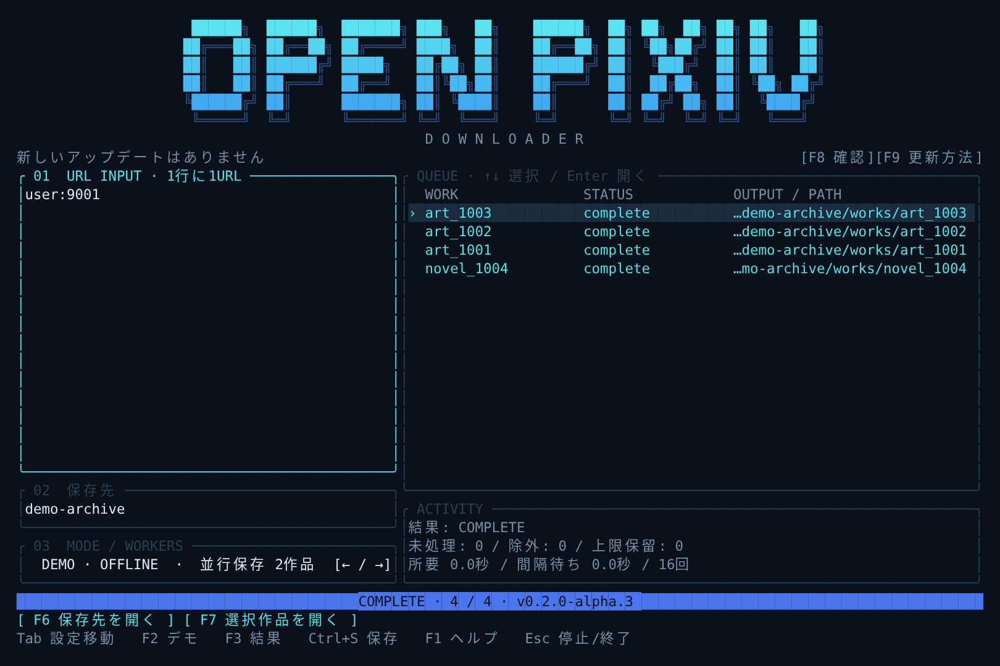

# Open Pixiv Downloader

**Rust + Ratatui** のローカル保存ツールです。大きな立体文字のロゴから起動し、作品・作者・小説シリーズのURLをまとめて入力できます。Windowsを優先して開発しています。

**v0.3.0-alpha.1 uses English by default.** To switch to Japanese, press **F10**, move to **Language** with Tab, choose **日本語** with ← / →, then press **Enter**. Your language and other settings are remembered after restarting. Press Esc to discard changes.

**初期言語は英語です。** 日本語にするには **F10 → Tabで「Language」へ → ← / → で「日本語」→ Enter**。言語・保存先・並列数などの設定は再起動後も引き継ぎます。Escで変更を取り消せます。



*合成4作品の保存後。実際のLinux端末出力を120桁×36行で取得し、レンダリングした表示例です。Windows実機のスクリーンショットではありません。*

研究用α版です。実サイトでの4形式の取得、本人セッションとの連携、Windows実機の操作は未検証です。作品の更新検出・旧版保持は未実装です。Pixivの公式製品ではありません。

## 起動

[Rust 1.89以降の現行stable版](https://www.rust-lang.org/tools/install)を用意し、PowerShellを開きます。Windowsでソースからビルドする場合は、Rustの案内に従いVisual Studio Build ToolsのC++ビルド環境も導入してください。

```powershell
cargo install --git https://github.com/ELRdn/Open-Pixiv-Downloader.git --branch main --locked --force
opixiv
```

alpha.6以降の更新は **`opixiv update`** で行えます。以前の版を使用中なら、今回だけ上のCargoコマンドで更新してください。作業フォルダーの移動や `git pull` は不要です。リポジトリから開発・試用する場合は、cloneしたフォルダー内で `cargo run --release --locked` を使えます。Rust版の実行にPythonは必要ありません。デモ用データも実行ファイルに組み込まれています。

以前Python版の `opixiv` をインストールしていた場合は `opixiv --version` を確認してください。新しいRust版は `opixiv 0.3.0-alpha.1` です。古いコマンドが優先される場合は、PowerShellで `& "$env:USERPROFILE\.cargo\bin\opixiv.exe"` と直接起動できます。

## 操作

URL欄へ1行に1URLを貼り付け、Tabで保存先・並行数へ移動します。作者URLとタグ検索URLにも対応します。**Ctrl+S → Enter** で確認して保存開始。初めて試すときは **F2 → Ctrl+S → Enter** で、架空の4作品を通信せず保存できます。

| キー | 操作 |
|---|---|
| Tab / Shift+Tab | URL・保存先・並行数・作品一覧を移動 |
| Enter | URL欄で改行、確認画面で保存開始 |
| F2 | デモ／匿名オンラインを切り替え。入力と保存先はモード別に保持 |
| F3 | 結果・欠損・停止理由の詳細。↑↓でスクロール |
| F4 | 画像・小説の集約。Enterで既存分を集約・補完、I / Nでフォルダーを開く |
| Alt+I / Alt+N | 集約した画像／小説のフォルダーを開く。画面下のボタンでも操作可能 |
| F5 | 対象一覧を確認。媒体はダウンロードしない |
| Ctrl+S | 保存内容の確認を開く |
| Alt+V | 選択した保存先の整合性を検査 |
| Alt+E | 完成済み作品を「保存先名-export.zip」へ出力 |
| ← / →、1〜8 | 並行数欄で同時保存数を設定 |
| ↑ / ↓、PgUp / PgDn | 一覧で作品を選択。Enterでそのフォルダーを開く |
| F6 / F7 | 保存先／選択した作品のフォルダーを開く。画面下のボタンもクリック可能 |
| F8 / F9 | 最新版を再確認／更新方法を開く。ロゴ下のボタンもクリック可能 |
| F10 | 保存モード・並列数・全体/APIの開始間隔・要求予算・言語を変更し、再起動後も記憶 |
| F11 / Ctrl+R | 保存先にある最新の対象一覧から再開。URLの再入力や作者一覧の再取得は不要 |
| F1 | ヘルプ |
| Esc / Ctrl+C | 実行中は停止を要求し、処理終了を待つ。待機中は終了 |

一覧は `WORK`・`STATUS`・`OUTPUT / PATH` の3列です。実際に作成された作品フォルダーを表示し、長いパスは末尾を残して省略します。F3ではフルパスを確認できます。検査後も行を保持し、再開でスキップした保存済み作品も表示します。Windowsはエクスプローラー、macOSはFinder、Linuxは既定のファイルマネージャーを呼び出します。

16個のURLを貼った場合、既定では2ワーカーで本文・素材の各段階を進めます。並行数は1〜32。作者URLは列挙できたイラスト・漫画・うごイラ・小説に展開し、単体URLとの重複を除きます。TUIは作品数の選択上限なし、要求予算は既定20,000回でF10から変更できます。本文利用可能数と全素材完了数は別に表示します。**F5で一覧確認 → F11で同じ一覧を保存**することもできます。[大量保存と再開の使い方](docs/BULK_DOWNLOAD_JA.md)を参照してください。

ロゴは `█` の面と `╔═╝` などの影を描き分けます。横幅・高さに応じてロゴと2カラムを縮小し、`NO_COLOR` で色を無効にできます。大きなロゴは、たとえば120桁×36行のWindows Terminalで表示できます。画面が狭い場合は短いロゴ・縦配置になります。

### 小説の本文だけが必要な場合

F10で「本文のみ TXT」を選ぶと、`archive/novel/novel_<作品ID>.txt` に直接保存します。画像・作品別JSON・HTML・本文の重複コピーを作りません。同じパスの既存TXTを確認し、旧形式の本文も再利用します。再開・ハッシュ検査用の管理情報は保持します。F10では並列数1〜32、要求予算1〜100万回も設定でき、Enterで記憶します。alpha.18から要求予算を **0** にすると **∞（無制限）** になり、再起動後も引き継ぎます。詳細は[本文専用モードと設定の保存](docs/BULK_DOWNLOAD_JA.md#本文だけを保存するalpha10以降)を参照してください。

## ツールの更新通知

起動時にGitHubの最新版をバックグラウンドで確認します。その後は保存処理が動いていないときに1時間ごとに確認し、新しいバージョンがあればロゴの下へ **「アップデートが利用できます！」** と表示します。同じバージョンのコミットだけでは通知しません。

**`opixiv update`** で最新版を確認し、必要ならビルド・検証して現在の実行ファイルを更新します。確認だけなら `opixiv update --check`、同じ版を再インストールする場合は `opixiv update --force`。Rust/CargoとGitが必要です。

**F9 → Enter** でツールを終了し、PowerShellへ貼り付ける `opixiv update` を表示します。保存処理の実行中はこの操作で終了せず、完了後に更新へ進めます。F8で手動再確認でき、再確認の間隔は最低1分です。

更新確認は固定のGitHub URLへ接続します。合成デモの保存処理とは別の通信です。完全にオフラインで起動する場合は `opixiv --no-update-check`、または環境変数 `OPIXIV_NO_UPDATE_CHECK=1` を使用してください。引数付きの保存・検査コマンドでは更新確認をしません。`update` は明示的な更新操作として確認します。通信失敗時は確認できなかった旨を表示し、作品の保存操作は続けられます。[更新確認の仕様](docs/UPDATES_JA.md)も参照してください。

## 必要なファイルだけを集める

作品別の保存に加えて、`archive/works/image` と `archive/works/novel` へコピーを自動で作ります。小説本文は、表紙・挿絵の取得完了を待たず先に集約します。

```text
archive/works/
├─ image/
│  ├─ art_130117333_p0000.jpg
│  └─ art_130117333_p0001.jpg
├─ novel/
│  └─ novel_29500410.txt
├─ art_130117333/       （従来の作品別保存）
└─ novel_29500410/      （従来の作品別保存）
```

小説は `plain.txt` の本文を作品ID付きの `.txt` に、画像は元画像を作品ID・ページ番号付きの名前にします。うごイラは元ZIPとフレームの表示時間のJSONを集約します。小説の表紙・挿絵・構造付きHTMLは作品別フォルダーに残ります。`raw.json` や作品のmanifestは集約フォルダーへコピーしません。

既存の保存済み作品は **F4 → Enter**、または次で通信せずに集約できます。

```powershell
opixiv collect archive
```

**Alt+Iで画像、Alt+Nで小説のフォルダーを開けます。** 同じ内容のファイルは増やさず、削除した集約ファイルは再集約で補完します。集約先で編集したファイルや同名の異なるファイルは上書きせず、F3と `collection-report.json` に問題を表示します。

集約は独立したコピーなので、集約先を編集しても作品別の元ファイルは変わりません。その分、画像などのコピーに必要なディスク容量を使います。集約先の名前はIDを基準に固定し、複数作品の `0000.jpg` や `plain.txt` が衝突しないようにしています。[詳しい仕様](docs/COLLECTION_JA.md)を参照してください。

## 保存コア

- イラスト・漫画：元画像とページ順を保存し、ページ数を照合。
- うごイラ：元ZIPとフレーム順・表示時間を保存。全メンバーを読み、CRCエラーを検出。変換はしない。
- 小説：原文・読みやすいテキスト・オフラインHTMLを保存。章、改ページ、ルビ、太字・斜体、リンク、表紙、許可された挿入関係の画像を扱う。未知の記法は消さずに表示。
- 保存状態：SQLite、SHA-256付きmanifest、原子的なファイル確定、排他的な実行ロック。再開時は整合性を確認し、完了済み作品をスキップ、破損した素材を再取得。
- 不足・失敗・停止を完了と区別。ZIP出力は整合性検査後の完成済み作品だけを対象にする。

既存Python版のアーカイブと同じ保存形式を使用します。合成4形式について、両方向の検査・再開・ZIP出力と原本バイト列の一致を確認しています。生成するHTMLの装飾やJSONの空白は同一ではありません。作品の更新検出と旧版保持は、再開とは別に今後追加します。

## コマンドで使う

引数付きコマンドはJSONを返します。標準入力・出力がパイプの場合、引数なしのTUIは開始しません。

```powershell
opixiv plan user:9001 --demo --all --out demo-archive
opixiv fetch user:9001 art:1001 --demo --all --jobs 2 --out demo-archive
opixiv verify demo-archive
opixiv collect demo-archive
opixiv pack demo-archive demo-export.zip

# UTF-8の一覧ファイル。空行、#コメント、BOMに対応
opixiv plan --input urls.txt --online --all --out archive
opixiv fetch --input urls.txt --online --all --jobs 2 --out archive
```

`--demo`、`--fixture examples/synthetic-fixture.json`、`--online` のいずれかを指定します。`--types art|novel|all`、`--limit`、`--retry-unavailable`、`--request-budget`、`--balanced`、`--api-interval`、`--resume`、`--max-file-mib` も利用できます。

### タグ検索の全件保存

小説トップの `https://www.pixiv.net/novel` から広く取得する場合は、[固定ID範囲の小説取得](docs/ALL_NOVELS_JA.md)を使います。初回に上限IDを指定し、その後はTUIの同じURL・F11でも再開できます。新着一覧をPixiv全期間の一覧と見なす方式ではありません。

Pixivの検索結果URLをTUIへ貼り付け、**F5 → F11 → Enter** で一覧確認・保存できます。イラスト・漫画・小説をページ送りして列挙し、重複を除きます。CLIでは全件指定の `--all` を付けます。

```powershell
cargo run --release --locked -- fetch "https://www.pixiv.net/tags/猫/artworks" --online --all --balanced --jobs 4 --out tag-archive
# 同じ対象一覧から再開。検索はやり直さない
cargo run --release --locked -- fetch --resume --online --all --balanced --jobs 4 --out tag-archive
```

`/artworks`・`/illustrations`・`/manga`・`/novels` に対応し、カテゴリのない `/tags/タグ名` は画像と小説を対象にします。URLの検索条件を引き継ぎ、ページ番号だけは1から開始します。未指定ならタグ完全一致・全年齢・新しい順です。未対応の条件は無視せずエラーにします。検索側の上限・結果の変動などで総件数まで列挙できなければ停止し、全件取得済みとは扱いません。公開・全年齢と確認できる作品のみ保存します。検索一覧の取得に失敗した場合は、条件を絞って元のURLから再実行してください。

`https://www.pixiv.net/search?q=R18&s_mode=tag_tc&type=novel` の形式もそのまま貼り付けられます。`q` の検索語と検索条件を引き継ぎ、小説の `tag_tc`（タグ・タイトル・キャプション）、`tag`（タグのみ）、`tag_full`（タグ完全一致）、`text`（本文）をAPIの指定へ変換します。`R18` という語を指定しても年齢制限フィルターは変えません。

匿名検索が10ページで打ち切られる場合は、日付範囲を自動分割して続きを列挙します。開始日付きの期間検索は365日以内に分け、単一日は新しい順・古い順の両方で検索します。alpha.19では密集日を「語を含む／含まない」に再分割し、元の検索条件・総数・観測IDを照合して元の日時順で統合します。小説の単一タグ完全一致では、ページ内でIDが省略されるケースを周辺IDの作品情報で補完します。APIが一覧に出さない公開作品も、日付・年齢区分・タグ条件が一致し、総数を満たす場合だけ追加します。分割できない条件、補完の窓外、検索中の変動などで不足が残る場合は未完了として停止します。詳細は[密集日の調査と検証](docs/TAG_SEARCH_DEBUG_JA.md)を参照してください。

作品一覧は最大1,000万件、再開用JSONは512MiBまでです。要求予算は別に1〜100万回、alpha.18から **0で無制限** を指定できます。有限予算の到達時はF11で再開できます。

一覧の列挙中に予算切れ・取消になった場合も、取得済みのページを保存します。**F11／`--resume` で列挙の続きから再開**でき、ページの再利用は通信予算を消費しません。URLから新しく実行すると一覧を取り直します。alpha.8以前の未確定一覧は再開できないため、更新後の初回はURLから実行してください。詳細は[タグ検索の不具合調査](docs/TAG_SEARCH_DEBUG_JA.md)を参照してください。

小説だけを保存する場合は `https://www.pixiv.net/tags/タグ名/novels` を入力してください。ブラウザからコピーした `?work_lang=ja&r=1`、`?p=2&work_lang=ja&r=1` 付きURLにも対応します。`r=0`／`r=1` を保持し、`p=2` が付いていても全件列挙は1ページ目から始めます。末尾のないタグURLをCLIで小説だけに絞る場合は `--types novel` を指定できます。

CLI・TUIの既定要求予算は20,000回、上限は1,000,000回です。これは作品数ではなく通信回数で、画像枚数や再試行によって消費量が変わります。`--request-budget`／F10で変更できます。詳細は[大量保存と再開](docs/BULK_DOWNLOAD_JA.md)を参照してください。

オンラインのリクエスト開始間隔は全ワーカーで共有します。TUIは通信分離（既定は全体1秒・API2秒・媒体1秒）、CLIは既定2秒で `--balanced` により通信分離を選べます。F10またはCLIの `--interval`（全体・媒体）と `--api-interval`（API）で開始間隔を指定できます。通信分離時の入力範囲は各0.001〜3600秒で、APIには全体・APIの両方の間隔が適用されます。401・403・429、リダイレクト、HTML応答では全体を停止します。API・媒体の一時的な通信失敗・5xxは追加最大2回の有限再試行を行い、予算を消費します。401・403・429や404・410では自動再試行しません。保存済みの対象からは `--resume` またはF11で再開できます。`--all` は作品数の選択上限を外す指定で、要求予算や閲覧条件を変更しません。現状は匿名取得のみ、公開・全年齢と確認できる作品だけを対象とします。

## 速度について

互換設定の「リクエスト開始間隔2秒」は、APIと画像取得の全ワーカーで共有するツール側の設定です。1枚絵を16作品、新規保存すると、詳細16回＋ページ情報16回＋画像16回の約48リクエストとなり、開始間隔だけで少なくとも約94秒かかります。作者URLの列挙や追加素材があればさらに増えます。並行数4でも、転送の重なりが増える一方で、この開始間隔は共有されます。

さらに転送・原子的な書き込み・ハッシュ照合・うごイラのCRC検査がかかります。利用者の回線・ストレージ別の内訳は未測定です。新しい実行結果には所要時間、送信間隔の待機時間、リクエスト数を表示し、F3と `last-run.json` でも確認できます。送信間隔の待機は他作品の転送と重なるため、所要時間から差し引いた値を転送時間とは扱いません。詳細は[速度の仕組み](docs/SPEED_JA.md)を参照してください。

同じ表紙の取得共有、本文の先行確定、欠損だけの修復、通信制御の分離、予算到達時の保存継続に対応します。TUIは通信分離で起動し、F10から互換設定へ戻せます。2600作品の1枚絵ではAPIだけで約5200回必要なため、既定のAPI間隔2秒では開始間隔による理論下限は約2時間53分です。実際には画像転送・保存・検査などが重なり、さらに時間がかかる場合があります。[使い方と制約](docs/BULK_DOWNLOAD_JA.md)、[元の性能分析](docs/PERFORMANCE_REVIEW_JA.md)も参照できます。

APIの2秒や並行上限はツール側の設定であり、Pixiv側の公表値ではありません。並行上限は8ワーカー、通信全体は8件・APIは最大4件です。並列数を増やしても開始間隔は共有されます。例えば、次の指定で全体・APIを0.5秒に設定できます。この値での実サイトの速度や許容頻度は未検証です。401・403・429では全体停止します。

```powershell
cargo run --release --locked -- fetch user:作者ID --online --all --balanced --interval 0.5 --api-interval 0.5 --jobs 8 --out archive
```

## 開発と検証

```sh
cargo fmt --check
cargo clippy --locked --all-targets -- -D warnings
cargo test --locked
cargo build --locked
python tools/check_rust_compat.py target/debug/opixiv
python tools/check_bulk.py target/debug/opixiv --count 4000
```

Windowsの互換性確認では最後のパスを `target/debug/opixiv.exe` にしてください。Pythonは旧版との比較検証にのみ必要で、Rust版の実行時には呼び出しません。

Rustテスト94件、旧Pythonテスト49件、両方向のアーカイブ互換性検査をLinuxで実施しています。実ターミナルでもデモ保存・検査・ZIP出力・終了を確認済みです。GitHub ActionsにWindows／Linuxのビルド・テストと実行ファイルのartifact出力を追加しています。CIの成功とWindows実機での表示確認は区別します。

| 場所 | 内容 |
|---|---|
| `rust/`、`Cargo.toml`、`Cargo.lock` | 現行のRust製CLI・Ratatui・保存コア |
| `src/pixiv_archive/`、`run.py`、`tests/` | 比較検証用の旧Python版。`python run.py` で従来画面を起動 |
| `examples/` | 自作の合成fixture・ネットワーク不要の性能再現コード。実作品・認証情報なし |
| [Windows診断拡張](tools/windows-probe/README_JA.md) | 通常閲覧セッションでメタデータを確認する補助ツール |
| [移行記録](docs/RUST_MIGRATION_JA.md)・[検証状況](docs/STATUS_JA.md) | 移行の範囲と既知の不足 |
| [計画](docs/PLAN_JA.md)・[OSS比較](docs/COMPARISON_JA.md) | 目標と採用判断 |

旧Python版のテストは `python run_tests.py`、診断拡張のテストは `node --test tools/windows-probe/collector.test.mjs` です。診断拡張は画像本体や小説本文を収集するものではありません。

## 既知の不足と利用条件

開発環境での本人セッションとの連携、4形式の実サイト互換性、Windows実機、全小説記法・媒体デコーダーによる照合は未検証です。クラウドからの作品APIはHTTP 403で、取得可能と判定していません。作品の更新検出・旧版保持・GUIは未実装です。従来Python版にはうごイラZIPのCRC不一致を見逃すケースが残っています。

[公式ガイドライン](https://policies.pixiv.net/)の「アプリケーション、各種サービス等への使用について」には、クローラー等を用いた作品収集の禁止が明記されています。作者の許諾とサービス側の利用条件は別に確認し、自動取得方式の適合を確認済みとは扱っていません。

コードは[MIT](LICENSE)。来歴は[NOTICE](NOTICE.md)を参照してください。コードのライセンスは、作品の利用許可やサービスへのアクセス許可を付与しません。
