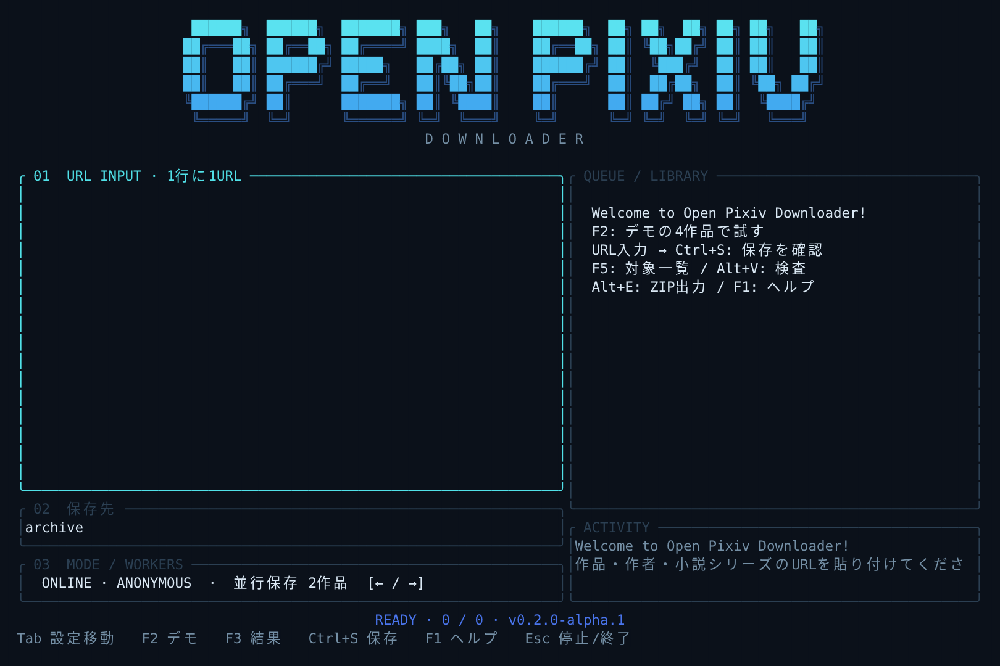

# Open Pixiv Downloader

**Rust + Ratatui** のローカル保存ツールです。大きな立体文字のロゴから起動し、作品・作者・小説シリーズのURLをまとめて入力できます。Windowsを優先して開発しています。



*実際のLinux端末出力を120桁×36行で取得し、レンダリングした表示例です。Windows実機のスクリーンショットではありません。*

研究用α版です。実サイトでの4形式の取得、本人セッションとの連携、Windows実機の操作は未検証です。更新検出・旧版保持は未実装です。Pixivの公式製品ではありません。

## 起動

[Rustの現行stable版](https://www.rust-lang.org/tools/install)を用意し、PowerShellでリポジトリのフォルダーを開きます。Windowsでソースからビルドする場合は、Rustの案内に従いVisual Studio Build ToolsのC++ビルド環境も導入してください。

```powershell
git pull
cargo install --path . --locked
opixiv
```

インストールせず試す場合は `cargo run --release --locked`。以後の更新は `git pull` の後に同じインストールコマンドを実行してください。Rust版の実行にPythonは必要ありません。デモ用データも実行ファイルに組み込まれています。

以前Python版の `opixiv` をインストールしていた場合は `opixiv --version` を確認してください。新しいRust版は `opixiv 0.2.0-alpha.1` です。古いコマンドが優先される場合は、PowerShellで `& "$env:USERPROFILE\.cargo\bin\opixiv.exe"` と直接起動できます。

## 操作

URL欄へ1行に1URLを貼り付け、Tabで保存先・並行数へ移動します。**Ctrl+S → Enter** で確認して保存開始。初めて試すときは **F2 → Ctrl+S → Enter** で、架空の4作品を通信せず保存できます。

| キー | 操作 |
|---|---|
| Tab / Shift+Tab | URL・保存先・並行数を移動 |
| Enter | URL欄で改行、確認画面で保存開始 |
| F2 | デモ／匿名オンラインを切り替え。入力と保存先はモード別に保持 |
| F3 | 結果・欠損・停止理由の詳細。↑↓でスクロール |
| F5 | 対象一覧を確認。媒体はダウンロードしない |
| Ctrl+S | 保存内容の確認を開く |
| Alt+V | 選択した保存先の整合性を検査 |
| Alt+E | 完成済み作品を「保存先名-export.zip」へ出力 |
| ← / →、1〜4 | 並行数欄で同時保存数を設定 |
| PgUp / PgDn | 作品一覧をスクロール |
| F1 | ヘルプ |
| Esc / Ctrl+C | 実行中は停止を要求し、処理終了を待つ。待機中は終了 |

16個のURLを貼った場合、既定では2作品を同時に保存し、終わった枠に次の作品を入れます。並行数は1〜4。作者URLは列挙できたイラスト・漫画・うごイラ・小説に展開し、単体URLとの重複を除きます。TUIは作品数の選択上限なしですが、共有の要求予算500件は維持します。

ロゴは `█` の面と `╔═╝` などの影を描き分けます。横幅・高さに応じてロゴと2カラムを縮小し、`NO_COLOR` で色を無効にできます。大きなロゴは、たとえば120桁×36行のWindows Terminalで表示できます。画面が狭い場合は短いロゴ・縦配置になります。

## 保存コア

- イラスト・漫画：元画像とページ順を保存し、ページ数を照合。
- うごイラ：元ZIPとフレーム順・表示時間を保存。全メンバーを読み、CRCエラーを検出。変換はしない。
- 小説：原文・読みやすいテキスト・オフラインHTMLを保存。章、改ページ、ルビ、太字・斜体、リンク、表紙、許可された挿入関係の画像を扱う。未知の記法は消さずに表示。
- 保存状態：SQLite、SHA-256付きmanifest、原子的なファイル確定、排他的な実行ロック。再開時は整合性を確認し、完了済み作品をスキップ、破損した素材を再取得。
- 不足・失敗・停止を完了と区別。ZIP出力は整合性検査後の完成済み作品だけを対象にする。

既存Python版のアーカイブと同じ保存形式を使用します。合成4形式について、両方向の検査・再開・ZIP出力と原本バイト列の一致を確認しています。生成するHTMLの装飾やJSONの空白は同一ではありません。更新検出と旧版保持は、再開とは別に今後追加します。

## コマンドで使う

引数付きコマンドはJSONを返します。標準入力・出力がパイプの場合、引数なしのTUIは開始しません。

```powershell
opixiv plan user:9001 --demo --all --out demo-archive
opixiv fetch user:9001 art:1001 --demo --all --jobs 2 --out demo-archive
opixiv verify demo-archive
opixiv pack demo-archive demo-export.zip

# UTF-8の一覧ファイル。空行、#コメント、BOMに対応
opixiv plan --input urls.txt --online --all --out archive
opixiv fetch --input urls.txt --online --all --jobs 2 --out archive
```

`--demo`、`--fixture examples/synthetic-fixture.json`、`--online` のいずれかを指定します。`--types art|novel|all`、`--limit`、`--retry-unavailable`、`--request-budget`、`--max-file-mib` も利用できます。

オンラインのリクエスト開始間隔は全ワーカーで共有し、既定2秒。401・403・429、リダイレクト、HTML応答では全体を停止します。自動リトライはせず、再実行で再開します。`--all` は作品数の選択上限を外す指定で、要求予算や閲覧条件を変更しません。現状は匿名取得のみ、公開・全年齢と確認できる作品だけを対象とします。

## 開発と検証

```sh
cargo fmt --check
cargo clippy --locked --all-targets -- -D warnings
cargo test --locked
cargo build --locked
python tools/check_rust_compat.py target/debug/opixiv
```

Windowsの互換性確認では最後のパスを `target/debug/opixiv.exe` にしてください。Pythonは旧版との比較検証にのみ必要で、Rust版の実行時には呼び出しません。

Rustテスト25件、旧Pythonテスト49件、両方向のアーカイブ互換性検査をLinuxで実施しています。実ターミナルでもデモ保存・検査・ZIP出力・終了を確認済みです。GitHub ActionsにWindows／Linuxのビルド・テストと実行ファイルのartifact出力を追加しています。CIの成功とWindows実機での表示確認は区別します。

| 場所 | 内容 |
|---|---|
| `rust/`、`Cargo.toml`、`Cargo.lock` | 現行のRust製CLI・Ratatui・保存コア |
| `src/pixiv_archive/`、`run.py`、`tests/` | 比較検証用の旧Python版。`python run.py` で従来画面を起動 |
| `examples/` | 自作の合成fixture。実作品・認証情報なし |
| [Windows診断拡張](tools/windows-probe/README_JA.md) | 通常閲覧セッションでメタデータを確認する補助ツール |
| [移行記録](docs/RUST_MIGRATION_JA.md)・[検証状況](docs/STATUS_JA.md) | 移行の範囲と既知の不足 |
| [計画](docs/PLAN_JA.md)・[OSS比較](docs/COMPARISON_JA.md) | 目標と採用判断 |

旧Python版のテストは `python run_tests.py`、診断拡張のテストは `node --test tools/windows-probe/collector.test.mjs` です。診断拡張は画像本体や小説本文を収集するものではありません。

## 既知の不足と利用条件

本人セッションとの連携、4形式の実サイト互換性、Windows実機、全小説記法・媒体デコーダーによる照合は未検証です。クラウドからの作品APIはHTTP 403で、取得可能と判定していません。更新検出・旧版保持・GUIは未実装です。従来Python版にはうごイラZIPのCRC不一致を見逃すケースが残っています。

[公式ガイドライン](https://policies.pixiv.net/)の「アプリケーション、各種サービス等への使用について」には、クローラー等を用いた作品収集の禁止が明記されています。作者の許諾とサービス側の利用条件は別に確認し、自動取得方式の適合を確認済みとは扱っていません。

コードは[MIT](LICENSE)。来歴は[NOTICE](NOTICE.md)を参照してください。コードのライセンスは、作品の利用許可やサービスへのアクセス許可を付与しません。
