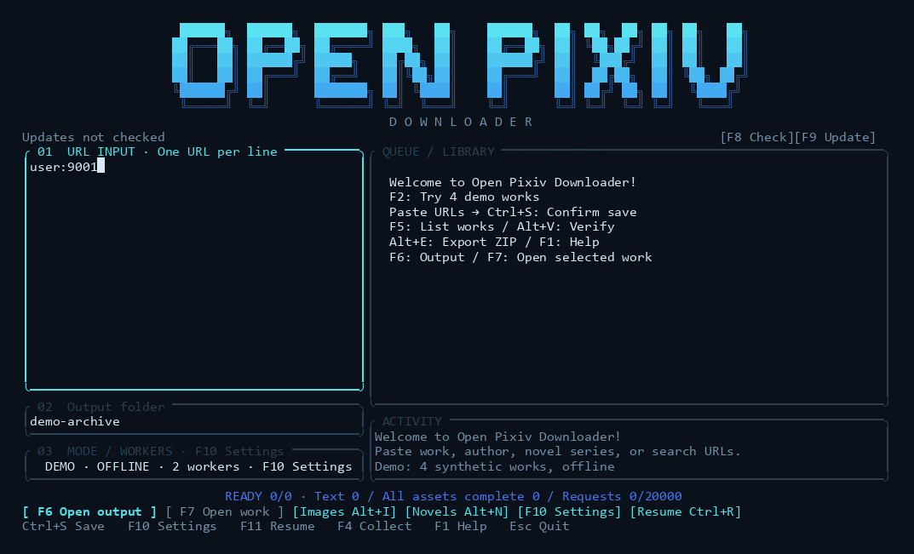
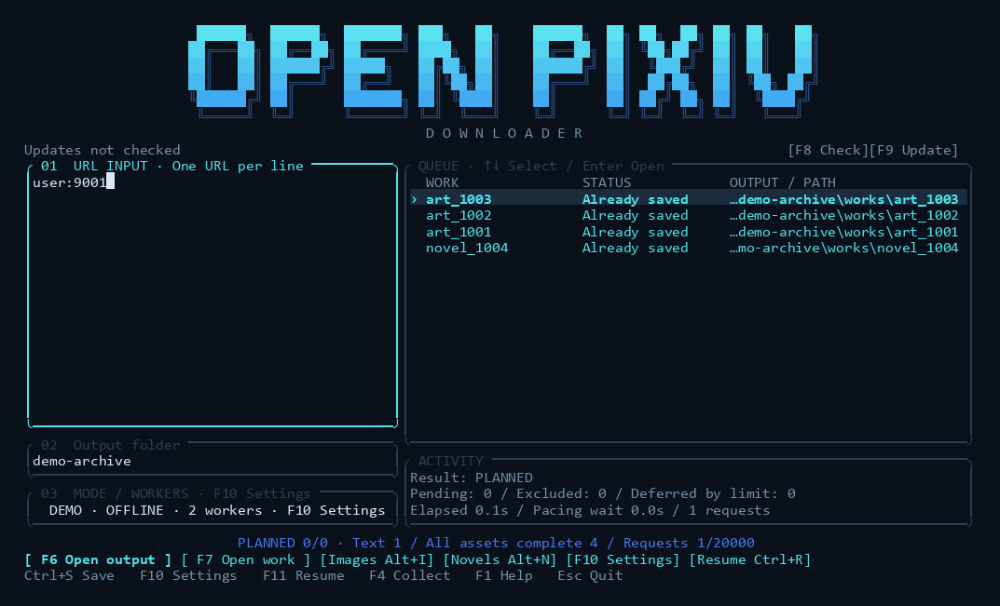
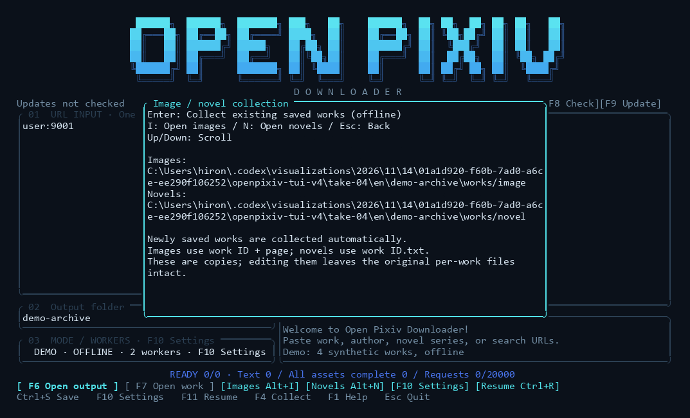

# OpenPixiv

### Your favorites. Saved together.

Batch-save illustrations and novels from creators, tags, or multiple URLs. Review your list, keep a local archive, and pick up where you left off—all from one terminal.

**English** · [日本語](README.ja.md)

[Live website](https://openpixiv.pages.dev/?lang=en) · [Download](#install) · [First save](#your-first-save) · [FAQ](#faq) · [Docs](docs/README.md)



*Actual Windows TUI · v0.3.0-alpha.1 · four synthetic works in a prepared archive. The recording shows listing and resuming, not live Pixiv downloads.*

## Install

**Download → extract → open a terminal beside the executable.** No Rust or Python needed for these binaries.

| Platform | Download | Launch |
| --- | --- | --- |
| Windows x64 | [Download ZIP](https://github.com/ELRdn/Open-Pixiv-Downloader/releases/download/v0.3.0-alpha.1/opixiv-v0.3.0-alpha.1-windows-x86_64.zip) | `.\opixiv.exe` in PowerShell |
| Linux x64 | [Download tar.gz](https://github.com/ELRdn/Open-Pixiv-Downloader/releases/download/v0.3.0-alpha.1/opixiv-v0.3.0-alpha.1-linux-x86_64.tar.gz) | `./opixiv` |

[Release notes & checksums](https://github.com/ELRdn/Open-Pixiv-Downloader/releases/tag/v0.3.0-alpha.1) · Alpha software; Windows is the primary development platform.

<details>
<summary>Build from source with Cargo / other platforms</summary>

Install [Rust stable 1.89+](https://www.rust-lang.org/tools/install) and Git. On Windows, follow Rust's instructions for the Visual Studio C++ build tools.

```sh
cargo install --git https://github.com/ELRdn/Open-Pixiv-Downloader.git --branch main --locked --force
opixiv
```

The Rust app does not call Python. macOS does not have a prebuilt download in this release.

</details>

## Your first save

**Try the offline demo first:** start `opixiv --no-update-check`, then press **F2 → Ctrl+S → Enter**. It uses four built-in synthetic works and writes to `demo-archive` without contacting Pixiv. With a downloaded Windows binary, use `.\opixiv.exe --no-update-check`.

For your own archive:

1. **Add your sources.** Paste one work, creator, novel-series, or tag-search URL per line. Use **Tab** to choose the output folder.
2. **Review the list.** Press **F5** to list matching works without saving their media. This step makes requests in online mode.
3. **Save together.** Press **F11 → Enter** to save the reviewed list. **F6** opens the output folder; **F4** shows the image and novel collection paths.

Already know what to save? **Ctrl+S → Enter** starts directly from your URLs. Check [current scope and usage conditions](#current-scope) before online use.

**日本語にする:** **F10 → TabでLanguage → ← / →で日本語 → Enter**。再起動後も設定を引き継ぎます。

## One workflow, fewer repeated steps

| You want to… | In OpenPixiv |
| --- | --- |
| Save a creator's works together | Add a creator URL; review with **F5** |
| Continue after stopping | **F11** / **Ctrl+R** resumes the latest selection and skips saved works |
| Find the files you saved | **F6** opens output; **F7** opens the selected work |
| Keep only novel text | **F10 → Save mode → Text-only TXT → Enter** |
| Adjust language, workers, or pacing | **F10**; **Tab** between fields, **← / →** to change choices, **Enter** to remember |
| See missing assets or a stop reason | **F3** |
| Check saved files / export a ZIP | **Alt+V** / **Alt+E** |
| Stop a running job / close when idle | **Esc** / **Ctrl+C** |

Need all shortcuts? Press **F1** in the app. [Detailed usage reference (日本語)](docs/USAGE_JA.md).

<details>
<summary>See the actual listing, resume, and output-folder recordings</summary>

| List works | Resume saved works | Inspect output paths |
| --- | --- | --- |
| [](website/public/recordings/batch-en.gif) | [](website/public/recordings/resume-en.gif) | [](website/public/recordings/outputs-en.gif) |

Open a thumbnail to play its GIF. All three recordings use the actual v0.3.0-alpha.1 app with synthetic data.

</details>

## Prefer commands?

The CLI returns JSON and supports the same archive. These examples use the offline demo:

```sh
opixiv plan user:9001 --demo --all --out demo-archive
opixiv fetch user:9001 --demo --all --out demo-archive
opixiv verify demo-archive
opixiv collect demo-archive
opixiv pack demo-archive demo-export.zip
```

Use `opixiv --help` or `opixiv fetch --help` for options. Run `.\opixiv.exe` instead of `opixiv` when using a downloaded Windows binary from its folder.

## FAQ

<details>
<summary><strong>Where are my files?</strong></summary>

The standard archive keeps each work under `archive/works/`. Collected image files are in `archive/works/image/`; novel TXT files are in `archive/works/novel/`. **F4** shows the paths. Text-only mode saves directly to `archive/novel/novel_<ID>.txt` and omits images, HTML, and per-work JSON.

</details>

<details>
<summary><strong>Can I resume without entering every URL again?</strong></summary>

Yes. Choose the same output folder and press **F11** or **Ctrl+R**. OpenPixiv uses the latest saved selection, checks existing files, and skips completed work. It can also continue listing after a request-budget stop or cancellation. It does not add newly published works to an existing selection; start again from the source URL to refresh it.

</details>

<details>
<summary><strong>How do I update?</strong></summary>

Close running instances, then run `opixiv update`. Self-update requires Rust/Cargo and Git. If you use only the downloaded binary, download and extract the new release, then launch its executable while continuing to use your existing output folder. **F8** checks for updates; **F9** shows instructions.

</details>

<details>
<summary><strong>Does it support every Pixiv work?</strong></summary>

Current online fetching is anonymous and limited to works confirmed public and all-ages. Illustrations, manga, ugoira source ZIPs/timing data, and novels have archive support, but live-site compatibility across all four formats is not fully validated. Account-session access, remote work-update detection, and version history are not implemented. See [validation status](docs/STATUS_JA.md).

</details>

## Current scope

OpenPixiv is an independent, MIT-licensed alpha project, not an official Pixiv service. The demos use synthetic data. Windows/Linux CI and the recorded TUI do not establish live-site compatibility or throughput.

Check permissions for the works and [Pixiv's usage conditions](https://policies.pixiv.net/) before online use. Pixiv's guidelines prohibit collecting works with crawlers; this project's automated fetching has not been established as compliant. The code license grants no rights to third-party works or access to the service.

[Documentation](docs/README.md) · [Development](docs/DEVELOPMENT.md) · [Landing-page source](website/) · [Issues](https://github.com/ELRdn/Open-Pixiv-Downloader/issues) · [MIT](LICENSE) · [Source notices](NOTICE.md)
