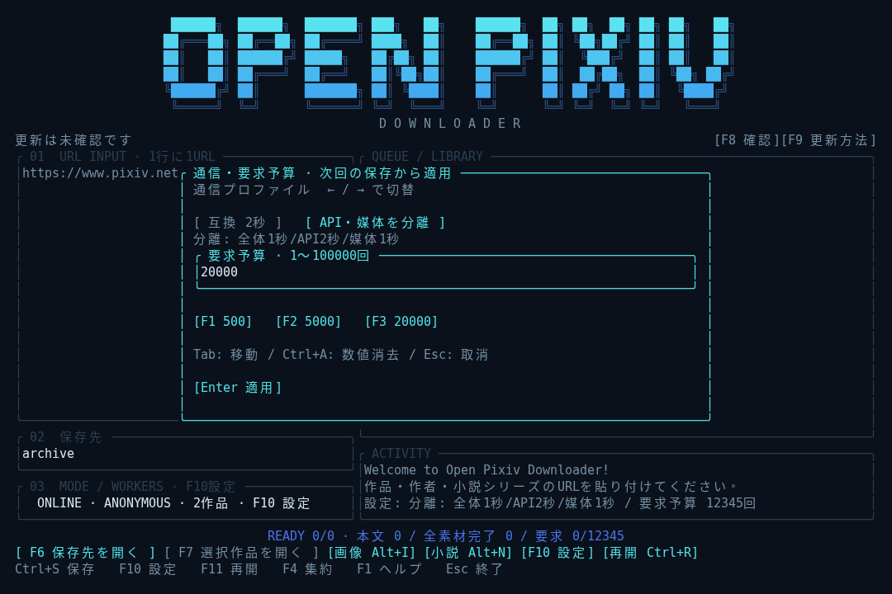

# 大量保存と再開

作者URLや複数作品URLを使った保存で、本文・全素材の進捗、要求予算、停止理由を確認できるようになりました。同じ表紙は取得を共有し、小説本文は表紙・挿絵の取得が終わる前から利用できます。



*Linux実端末の表示を取得して描画した例です。Windows実機の画面ではありません。*

## 更新して起動する

alpha.6以降は `opixiv update` で更新できます。alpha.5以前の版はこのサブコマンドに未対応なので、今回だけ起動中のツールを終了し、PowerShellで次の1行を実行します。リポジトリのフォルダーへ移動する必要はありません。

```powershell
cargo install --git https://github.com/ELRdn/Open-Pixiv-Downloader.git --branch main --locked --force
```

完了後は `opixiv` で起動します。保存先には以前と同じフォルダーを指定してください。既存アーカイブの再利用は、保存済みファイルの整合性を確認して行います。

## TUIで作者・タグ検索の作品を保存する

1. 作品URL・作者URL・タグ検索URLを入力し、保存先と並行数を確認します。
2. **F10**で通信方式と要求予算を設定します。保存中は変更できません。
3. 対象を確認してから始める場合は **F5**、確認が終わったら **F11**または **Ctrl+R**、確認画面でEnterを押します。
4. 入力したURLから直接保存する場合は **Ctrl+S → Enter** です。

F5は対象一覧を取得しますが、画像・表紙等の媒体は保存しません。F11は保存先にある最新の「確認した対象一覧」または「保存ジョブの対象一覧」を使います。以前のジョブがあっても、その後にF5で確認した一覧が新しければ、そちらを使います。

F11での再開では作者一覧を取り直さないため、途中で作者が作品を追加しても対象は増えません。作者の現在の全作品を確認し直す場合は、URLからF5またはCtrl+Sを実行してください。一覧列挙中の予算切れ・取消は取得済みページを保存し、F11で続きを確認できます。検索条件や結果の不整合による失敗は、元のURLから再実行します。古い別ジョブへは戻りません。

## F10：通信方式・開始間隔・要求予算

通信方式は左右キーまたはSpaceで切り替えます。Tabで予算・全体/媒体間隔・API間隔へ移動し、Enterで適用、Escで変更を取り消します。通信分離時は各0.1〜3600秒を指定でき、APIには全体・APIの両方の間隔が適用されます。設定画面のF1/F2/F3で500／5,000／20,000回を選択でき、数値も入力できます。

| 通信方式（秒数は既定値） | 全要求の開始間隔 | APIの開始間隔 | 媒体の開始間隔 |
|---|---:|---:|---:|
| 互換設定 | 2秒 | 2秒以上 | 2秒以上 |
| 通信分離・TUI起動時の既定 | 1秒 | 2秒以上 | 1秒以上 |

開始間隔と同時通信数は別の設定です。バランス設定でもネット通信は合計最大8件、APIはそのうち最大4件です。応答待ちの通信がある場合も、他の通信はこれらの制約内で進めます。表の間隔はツール側の設定で、提供側が公表した許容値という意味ではありません。

TUI・CLIの要求予算は既定20,000回です。どちらも1〜100,000回を指定できます。小説4,332作品を本文・固有表紙の各1要求で保存する場合、作者一覧を含めて概算8,665要求ですが、挿絵や再試行などで増えることがあります。20,000回で必ず完走するという保証ではありません。

予算は、実際に通信を開始した回数です。共有済み表紙のコピーやローカル検査は通信を増やしません。残予算は画面と結果で確認できます。予算到達時は新しい通信だけを止め、進行中の正常な取得・書き込み・検査を確定してから一時停止します。次回はF10で予算を確認し、F11で再開してください。自動で予算を補充して続行することはありません。

## 「本文が使える」と「全素材完了」を分けて確認する

小説本文を保存・検査した時点でTXTを集約します。表紙が遅い・取得できない場合も、保存済みの本文を読めます。

| 表示・結果 | 意味 |
|---|---|
| 本文保存済み／本文利用可能数 | 小説本文が保存され、利用できる状態です。表紙・挿絵が残っている場合があります |
| 素材待ち | 表紙・挿絵等を取得・補完する段階です |
| 完了／全素材完了数 | その作品の対象素材が揃い、保存後の検査を通過しています |
| 欠損・partial | 本文や一部素材は保存されていますが、不足があります。F3で内容を確認できます |
| 予算による一時停止 | 残りを保存対象一覧に残して停止しています。F11で再開できます |

本文の進捗が100%になっても、表紙・挿絵が残っていれば全素材完了にはなりません。画像・漫画・うごイラの作品に小説本文の状態は適用しません。ZIP出力は引き続き、検証済みの全素材完了作品を対象にします。

## 保存したファイルを開く

作品別の元ファイルに加え、必要な画像と小説本文を集約します。

```text
archive\works\novel_1004\plain.txt      小説の作品別本文
archive\works\novel\novel_1004.txt      読むための集約コピー
archive\works\art_1001\images\0000.png  作品別の原画像
archive\works\image\art_1001_p0000.png   原画像の集約コピー
```

**Alt+N**で小説、**Alt+I**で画像の集約先を開きます。**F6**は保存先、**F7**または作品一覧でEnterは選択作品のフォルダーを開きます。**F4 → Enter**では既存分の集約を通信なしで補完できます。

集約先は独立したコピーです。編集しても作品別の元ファイルには影響しません。集約先に内容の異なるファイルがある場合は上書きせず、衝突として報告します。別名にするか別の場所へ移すと、再集約できます。

## 同じ表紙の取得共有と欠損だけの修復

同じURLの表紙を複数作品が使う場合、同時取得をまとめ、取得済みデータから作品ごとに独立したファイルを保存します。ある作品の表紙ファイルを編集しても、他の作品の表紙や集約コピーには波及しません。

取得共有に使う一時キャッシュは実行単位で、保持容量の目標は512MiBです。使用中のファイルは保護し、容量・件数の上限等で削除されたデータは再取得することがあります。新しい実行で、URLだけを根拠に前回のキャッシュを無検証で使い回す方式ではありません。

再開時は保存済みの本文・素材を検査し、不足・破損だけを補修します。例えば、本文が正常で表紙だけ不足していれば、本文を再取得せず表紙を補います。原本が正常で集約コピーだけが消えていれば、再集約で復元できます。

再開は保存した時点の内容を完成させる操作です。作者の改訂を自動で検出して新版を保存する機能や、一般的な旧版管理は含みません。保存した内容との一致を確かめられない場合や、再取得した本文等が保存時の内容と異なる場合は `update_needed` 等を表示し、元ファイルを保護します。媒体を修復する際も、保存時のハッシュが分かる場合は同じ内容であることを確認し、同じURLで別のbytesが返った場合は置換しません。現在の内容を別途保存する場合は、以前の保存先を残して別の保存先を指定してください。

## 停止したとき

F3と保存先の `last-run.json` に、要求数・予算・本文と全素材の進捗・停止理由を記録します。予算到達、ユーザー取消、HTTP拒否等は別の理由として扱います。

EscまたはCtrl+Cで停止を要求できます。画面の停止受付と通信の終了は同時とは限らず、すでに接続・応答待ちに入っている通信は、現在のタイムアウトにより最大約30秒待つ場合があります。

401・403・429、リダイレクト、HTML等の想定外応答では新規要求を停止します。通常の一時的な通信失敗等の再試行は有限で、追加の要求予算を使います。エラーを押して無期限に再試行する方式ではありません。

同じ保存先を複数のプロセスで同時に書き込むことはできません。保存先の `.archive.lock` が終了後もファイルとして残るのは正常です。通常はプロセス終了でロックが解除されるため、このファイルを削除する必要はありません。旧版の `.run.lock` が残っているというエラーでは、旧版を含め全プロセスが終了していることを確認してから、その古い `.run.lock` だけを削除して再開します。実行中のロックを削除して並行起動しないでください。

## CLIから使う場合

長いコマンドを毎回入力したくない場合は、引数なしの `opixiv` と上記のTUI操作を使ってください。CLIでも同じ保存・検査・再開機能を利用できます。

```powershell
# 通信なしの合成4作品で試す
opixiv fetch user:9001 --demo --all --jobs 4 --request-budget 20000 --out demo-archive

# 同じ保存対象から再開する。作者・作品URLは付けない
opixiv fetch --resume --demo --all --jobs 4 --request-budget 20000 --out demo-archive

# 実サイト用の書式例。作者IDは自分の対象に置き換える
opixiv fetch https://www.pixiv.net/users/12345 --online --all --jobs 4 --balanced --request-budget 20000 --out archive

# 実サイト保存の対象一覧から再開する
opixiv fetch --resume --online --all --jobs 4 --balanced --request-budget 20000 --out archive

# 原本の検査、集約の補完
opixiv verify archive
opixiv collect archive
```

`--balanced` を省略すると互換設定です。`--interval` を指定した場合は全要求の間隔を変更でき、互換設定は2秒以上、バランス設定は1秒以上に制限されます。再開時の通信方式・予算も今回指定した値を使います。オンライン保存と合成デモは別のモードなので、保存時と一致するモードで再開してください。

キャッシュの保持目標は512MiBで、使用中のファイルと取得予約の合計は最大1.5GiBです。原本・集約のコピー用一時領域と完成ファイルは別に容量を使います。空き容量を事前に完全保証する仕組みではなく、ファイルI/O失敗は停止理由として報告します。

前回の素材失敗がHTTP 404/410だった場合は、明示的な再開で作品詳細を一度再確認します。画像のページ・フレーム情報や小説の挿入関係も必要に応じ照合し、参照が変わっていれば原本を保持して更新確認が必要と報告します。一般的な表紙の通信失敗を補修するたびに本文を再取得することはありません。

## 検証結果の読み方

同じ本文・画像を使った合成小説4,000作品で、共通表紙のケースは作者一覧1回＋本文4,000回＋表紙1回＝**4,002模擬要求**、全て異なる表紙URLでは**8,001模擬要求**で全件完了することを確認しました。完了済みの再開は0要求、破損した表紙1件の補修は1要求でした。予算到達・予算が必要数と一致する場合・集約コピーの編集も検査しています。

これはネット通信を行わないfixtureによる受入結果です。4000作品が実サイトで同じ時間に保存できるという性能測定ではなく、実サイトの速度・取得互換性・Windows実機での性能を保証するものでもありません。再現方法は `python tools/check_bulk.py target/release/opixiv --count 4000`。Windowsでは実行ファイルを `target/release/opixiv.exe` とします。

実測の内訳・性能上の根拠は [性能分析](PERFORMANCE_REVIEW_JA.md)、今回の実装目標と受入条件は [大量保存の改善計画](BULK_DOWNLOAD_PLAN_JA.md)を参照してください。
