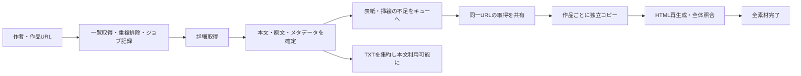

# 大量保存の改善計画

実装状況（alpha.5）：指定4項目を実装し、合成4000作品・ローカルHTTP・実Linux端末で検証した。[実装後の使い方と制約](BULK_DOWNLOAD_JA.md)、[検証状況](STATUS_JA.md)を参照。本書以下は当初の計画であり、設定値・対応済み項目の正確な状態は実装後の資料に記載する。Windows実機の受入は未完了。

作成日：2026年11月1日（日本時間）。対象：Rust + Ratatui、基準コミット `0936e387715f01d15eb0ee284d3b1a2223db87c7`。利用者から指定された「表紙の重複取得削減」「本文と素材補完の分離」「通信制御の再設計」「大規模ジョブの予算・再開表示」を、一つのリリースで提供するための計画。実装・新しい通信設定の適用は本書では行わない。

根拠は [性能分析](PERFORMANCE_REVIEW_JA.md) とその実測記録。今回のログは487要求・972.62秒で、現行2秒間隔の下限972秒に近い。一方、同一表紙の割合、Windowsのディスク時間、提供側が許容する要求率は未確定。倍率の保証には使わない。

## 目標と提供範囲

作者URLを貼り付けて保存を始め、4,000作品以上でも進捗・残予算・停止理由が分かり、途中から不足だけを補修できる。既定の保存対象は引き続き本文・構造・表紙・挿絵等の全素材。画像・漫画・うごイラを含む既存機能と、作品別原本・集約コピーの独立性も維持する。

今回に含めるのは指定4項目と、それらを正しく動かすための状態記録・計測・移行。Rust/Ratatuiを維持し、既存の共有HTTPクライアントも再利用する。Tokio全面移行、GUI、検索・ランキング、動画変換、遠隔の新版検出と一般的な旧版管理は別の開発範囲とする。1枚絵のAPI省略、HTTP/2・圧縮の導入も今回の完了条件には加えない。

## 実装する処理の流れ

ネット取得、検証・書き込み、集約は上限付きキューで接続する。CPUやディスクが詰まったときは前段を待たせ、作品数に比例してメモリや一時ファイルを無制限に増やさない。本文と素材のキューを公平に処理し、本文を全部取得するまで最初の作品の完成を待たせる設計にも、表紙1件で本文全体を止める設計にもしない。

## 1. 状態記録・本文保存・欠損修復

**実装順序では最初に着手する。** 表紙キャッシュや通信並列化より先に、どこまで保存できたかを復元できるようにする。

- ジョブに対象ID、選択条件、設定、段階別の進捗、要求使用数、停止理由を保存する。素材ごとに所属作品、役割、取得元、期待ハッシュ・サイズが分かる場合はその値、ローカル保存状態を記録する。
- 小説詳細の取得後、原文・本文TXT・メタデータを原子的に確定する。照合済み本文は素材取得を待たず `works/novel/novel_ID.txt` に集約する。
- 内部の段階は `metadata_ready`、`body_ready`、`assets_pending`、`verified`、集約状態を分ける。既存の作品statusはcomplete/partial等との対応を維持し、本文だけある作品をcompleteにはしない。
- 中断時にもmanifestへ保存済みファイルと未取得素材を記録する。取得後・manifest記録前にクラッシュした一時ファイルは未確定として再検証する。
- 再開では、保存した同一スナップショットのraw/本文/素材を検証し、不足・破損だけ取得する。原本が健全で集約コピーだけ不足していれば、オフラインでコピーを補う。
- 原本状態と集約状態を別に扱い、利用者が編集した集約コピーは上書きしない。衝突は集約の問題として表示する。
- 欠損素材のURLが古く404等になった場合だけ、必要な詳細情報を再確認する。本文や参照素材が変わっていれば新旧を混ぜて完了扱いにせず、今回の修復を保留し「更新の確認が必要」と報告する。旧内容を上書きしない。
- HTMLは本文確定時に未取得素材を示す形で生成でき、素材補完後に再生成する。リンク先ファイルの欠損を隠さない。packは引き続き全素材が検証できたcomplete作品のみ。

変更の中心：`rust/archive.rs`、`rust/jobs.rs`、`rust/collection.rs`、状態管理用の新モジュール。DBは追加テーブル中心の移行にし、既存worksとmanifestのkey/files/status契約を維持する。manifestの追加項目・互換性はバージョンとともに記録する。

## 2. 同一表紙の取得共有

- 表紙の正確なURLと取得文脈をキーに、取得中／成功／失敗を共有する。同時に4作品が同じ表紙を要求しても、最初の1取得を待つ。
- 取得済みデータは実行単位のディスクキャッシュへ置く。各作品への保存は通常の独立ファイルとし、ハードリンクやシンボリックリンクは使わない。
- キャッシュからのコピーもハッシュ・サイズを確認し、一時ファイルから原子的に確定する。キャッシュが壊れていれば使わず、必要な取得をやり直す。
- 保持容量と取得中の最大bytesを制限する。使用中エントリは削除しない。容量で退避・削除したURLの再取得は計測上のキャッシュミスとして扱うため、「全URLが常に一度だけ」とは保証しない。
- 同じ表紙の通信失敗は、待っている作品にも素材欠損として伝える。失敗を永久キャッシュせず、明示的な修復・次の実行で再試行可能にする。再試行枠は作品ごとでなく共有取得ごとに消費する。
- 実行をまたぐURLだけの無検証キャッシュは初期実装に含めない。取得元の更新を見逃さないため、再開の既存ファイル再利用は保存スナップショットと検証済みハッシュに基づく。

初期上限案：キャッシュ512MiB、ネット取得中最大4件、ネットで新たにステージする媒体は合計1GiB以内。既存のファイル上限256MiBを維持し、空き容量と予約bytesも確認する。予約が空くまで要求を開始せず待つ。上限や並行数を変えた場合もメモリ・ディスクの制限が破綻しないよう別途検証する。

変更の中心：`rust/transport.rs` と新しい共有媒体取得モジュール。キーのクエリは削除しない。ログにはURLや本文を出さず、匿名の識別子と集計値を使う。

## 3. 通信制御の再設計

要求を「API」「媒体」の2種類に分ける。媒体は許可済みpximg全体で一つのグループとし、ホスト名の違いで上限が増えないようにする。全要求にはさらに共通の開始間隔とジョブ予算を適用する。

- 中央の送信管理で、全体間隔・種類別間隔・同時通信数・残予算を満たす要求だけを送る。
- 許可の待機、DNS/TLS接続、ヘッダー待ち、本体転送中には状態管理のMutexを保持しない。開始予定を大量に前予約して、その後一斉送信する形にしない。
- 予算は実際に送信を開始するときに1回消費する。キャッシュヒットや許可前の取消では消費しない。再試行は追加消費する。
- 401/403/429等の停止応答を受信した時点で共有停止を確定し、新規要求を開始しない。すでに通信中の要求が存在することは許容し、停止後に新たに投入しないことを試験する。
- 通常の接続失敗、タイムアウト、一時的な5xxは分類する。共有素材につき追加最大2回、待機を置いた有限再試行を導入する案とし、上限はジョブ予算にも含む。404は通常再試行せず欠損・参照更新の判断へ進む。401/403/429の自動再試行はしない。
- 接続・ヘッダー・本体・全体の時間制限を区別する。新しい短いタイムアウトで正常な大きい媒体を切らないよう、遅い応答の比較試験で値を決める。

### 初期設定の提案

| 設定 | 互換設定 | 新設定の評価候補 |
|---|---:|---:|
| 全要求の開始間隔 | 2秒 | 1秒 |
| APIの開始間隔 | 2秒以上 | 2秒 |
| 媒体の開始間隔 | 2秒以上 | 1秒 |
| APIの同時通信上限 | 総数4以内 | 2 |
| 媒体の同時通信上限 | 総数4以内 | 4 |
| ネット通信の総数上限 | 4 | 4 |

互換設定は開始頻度を維持するための設定であり、新しい並行実装の挙動が全て旧版と同一という意味ではない。新設定は提供側の許容値として確認した数値ではなく、**実装前に判断する候補**。互換設定でコードの正しさを確認し、新設定を明示的に選択できるようにする。既定をどちらにするかは最後に判断する。

4,332小説・本文1要求＋固有表紙1要求・挿絵なしの場合、現在は開始間隔だけで約4時間49分。新設定でAPIと媒体を交互に送れれば約2時間24分が下限の目安になる。転送・検査・失敗を含む実測ではなく、共有表紙が何件あるかでも変わる。「並行数4だから4倍」とは説明しない。

変更の中心：`rust/transport.rs`、設定構造体、CLI引数。TUIとCLIで同じ設定・制約を使用する。Rustのblockingクライアントと固定ワーカープールで実装し、非同期ランタイムへの全面置換は前提にしない。

## 4. 大規模ジョブの予算・停止・再開とTUI

- TUIから有限の要求予算を指定できるようにする。初期案は通常500回、作者の大量保存用20,000回のプリセットと任意入力、上限100,000回。大量保存では開始画面で20,000回を提案し、実際の予算を明記する。現行CLIの5,000回上限も統一して変更する。
- 作者一覧取得後に発見・既存・除外・対象数、概算要求数、設定予算を表示する。概算は表紙・挿絵の未知分を明示し、全件完了の保証値にしない。表示した一覧をそのまま保存ジョブへ引き継ぎ、確認だけのために作者一覧を再取得しない。
- 予算到達では新規HTTP要求を停止し、進行中の成功した取得・書き込み・検査を完了させてチェックポイントを保存する。未着手・素材待ちは残し、全ワーカーへユーザー取消を流用しない。
- ユーザー取消、予算到達、HTTP拒否、通信失敗、ワーカー異常、容量不足を型付き停止理由にする。終了画面で「何が残ったか」「次回何を再開するか」を示す。
- 再開は明示操作で新しい予算を設定する。自動で予算を補充して続行しない。保存済みジョブの対象一覧から再開できるようにし、任意の作者の最新一覧更新とは操作を分ける。
- 表示を `WORK / STATUS / OUTPUT・PATH` のまま拡張し、状態に「本文保存済み」「素材待ち」「検証中」「完了」「欠損」「予算で一時停止」を出す。画像等には本文状態を表示しない。
- 全体には「本文利用可能数」「全素材完了数」「欠損数」「要求使用／上限」「API・媒体の実測要求率」「共有取得削減数」「段階別時間」を表示する。本文の進捗が100%でも全体完了としない。
- 既存のF4集約、画像／小説フォルダー、選択作品を開く操作を維持する。大量行は表示範囲だけ構築し、行更新はキー索引、描画は変更時を基本にする。

変更の中心：`rust/tui.rs`、`rust/jobs.rs`、`rust/main.rs`、停止制御用の新モジュール。予算・待機・停止フラグを単一boolにまとめない。

## 実装の依存関係とリリース手順

一つの更新として提供するが、確認できる単位で順に実装する。

| 順序 | 成果物 | 次へ進む条件 |
|---|---|---|
| 1 | 段階状態・素材台帳・停止理由・計測・旧アーカイブ移行 | alpha.1/alpha.4の既存原本を壊さず検査・再開できる |
| 2 | 本文の先行確定、素材修復、上限付きキュー | 表紙が失敗しても本文を利用でき、completeは誤表示しない |
| 3 | 共有表紙取得と独立コピー | 同時要求の重複排除、失敗・取消・破損に対応する |
| 4 | 新しい送信管理、予算処理、有限再試行 | 間隔・同時数・予算・拒否時停止を実ソケットで確認 |
| 5 | TUI設定・進捗・再開操作・大量行描画 | CLIとTUIの設定・結果が一致し、入力・取消が動く |
| 6 | A/B性能比較、4形式・Windows互換確認、説明更新 | 下記受入条件を満たした結果を添付して版番号を上げる |

DB移行はトランザクション内で行い、移行前の小さなDB/manifestを退避する。移行で原本媒体を再書き込みしない。新形式を旧バイナリへ書き込み可能だと保証せず、互換設定への切替と旧バイナリへのロールバックを区別する。互換性が変わる範囲を最終的なスキーマ差分に基づき案内する。

## 合格条件

1. **4000作品と共有表紙**：容量内に収まる同じ表紙を持つ合成4,000小説で、表紙HTTPは1回。全て固有の表紙のケースでも完走する。全コピーのbytes・ハッシュが一致し、一つの編集が他の作品や原本へ波及しない。
2. **欠損だけ修復**：本文保存後・表紙保存中・manifest確定前で停止し、再開で本文を再取得しない。本文や原本が破損している場合は検証で検出し、必要分だけ修復する。集約だけ不足した場合はHTTPなしで復旧する。
3. **停止と予算**：予算の最後の1回を複数ワーカーが競合しても超過しない。予算到達時は進行中の正常保存を保持する。拒否応答の受信後、後続の新規要求が出ない。停止理由が記録と画面で一致する。
4. **速度の因果関係**：同じ内容・同じ要求率設定の旧経路と比較し、遅いヘッダーによる他要求の足止めが解消することを確認する。新設定による速度差と、キャッシュ・処理構造の改善による速度差を別々に報告する。
5. **保存品質**：画像ページ数・順序、原媒体bytes、小説の原文・章・ルビ・挿絵関係、うごイラCRCを既存の期待値と独立した検査で照合する。欠損をcompleteにしない。既存39テストとアーカイブ互換性検査を適合させて通す。
6. **Windowsと大量表示**：Windows CIでビルド・検査、日本語と空白のあるパス、4,332行表示、フォルダーを開く、途中終了・再開を確認する。実機では入力・スクロール・取消が概ね200ms以内に画面へ反映されることを目標にし、既存HTTP待ちが解除される時間とは分ける。
7. **容量・安全な確定**：ディスク不足、キャッシュ上限、同時取得の失敗、コピー中取消を注入する。メモリ・一時領域の上限を守り、不完全ファイルや新旧の混在を完全保存として公開しない。

性能比較では要求/作品、完了作品/分、本文利用可能までの時間、全素材完了時間、再開から最初の未取得作品までの時間、TTFB/転送p50・p95、ピークRAM・一時領域、欠損率を記録する。模擬要求・loopback HTTP・実サイトの結果を混ぜない。実サイト試験は既存の自作・許諾済み素材で少数の機能確認から行い、いきなり4,332作品をA/Bで二重取得しない。

## 実装前に判断する項目と推奨案

- **保存範囲**：全素材を維持し、本文を先に利用可能にする案を推奨。本文のみモードは今回追加しない。
- **通信設定**：互換設定を残し、評価候補の「全体1秒・API2秒・媒体1秒」を選択可能にする案。新設定を既定にするかは未決定で、提供側の許容率の確認結果と合わせて判断する。
- **大量保存の予算**：作者向け20,000回を提案する有限予算とし、開始時に必ず現在値を表示する案。4,332小説の約8,665要求には余裕があるが、挿絵・漫画等が多ければ超えるため保証しない。

上の3点以外は通常の実装判断として進められる。完了速度の倍率は、表紙の重複率と通信設定・実測結果が分かるまで約束しない。
