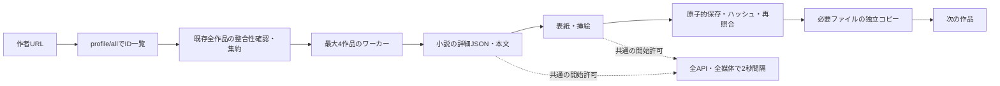

# 大量保存の性能分析と改善提案

分析日：2026年11月1日（日本時間）。実装調査の基準は `d903c3791479652f948756415c65263e2e577ff4`（0.2.0-alpha.4）。利用者のWindowsログは **0.2.0-alpha.1**。両者を混同しない。本書は調査・提案であり、製品の通信設定や保存品質を変更した記録ではない。

## 実測ログからの結論

今回の速度は、本ツールが設定した**全要求共通の2秒間隔**でほぼ説明できる。Rustの実行速度や回線帯域が主因だとする根拠はない。2秒はPixivの公表上限として決めた値ではない。

| 指標 | 提供されたログ／計算 |
|---|---|
| 並行数・発見数 | 4ワーカー・4,332作品 |
| 経過時間 | 開始・終了時刻の差：972.6197677秒（16分12.62秒） |
| 開始したHTTP要求 | 487回。失敗した要求も含む |
| 保存結果 | complete 231、partial 11、paused 4。既存完了1 |
| 2秒間隔の開始時刻の下限 | `(487−1)×2 = 972秒` |
| 下限／経過時間 | 約99.94%。待機時間の実測比率という意味ではない |
| 保存結果が出た作品あたりの要求 | `487÷(231+11) ≈ 2.01`。中断作品・作者一覧分も含む粗い値 |
| 欠損 | 提供分のpartial 11件は `cover.jpg` のHTTPS失敗 |
| 未着手 | 選択4,331作品中4,085作品 |

「小説4作品で約13秒」という短区間の観察より、この実行全体の記録を優先する。小説は本文を含む詳細JSONを1回、表紙があれば媒体をもう1回取得するため、本文のサイズが小さくても2回分の開始間隔を消費する。挿絵がある作品はさらに要求が増える。表紙なし小説は1要求になる。4作品が一緒に完了する表示と、全体の定常処理速度も区別する。

alpha.1には現在の詳細時間計測と集約コピーがない。したがって、**集約コピーはこのログの遅さの原因ではない**。時刻差は壁時計からの算出であり、ローカルの時計補正までは確認できない。[匿名化した計算根拠](evidence/speed-user-log-summary.json)を参照。

487回でpausedになった理由は確定できない。既定予算500回に到達したログではなく、共有のキャンセルフラグが立った結果は分かるが、ユーザー操作等の起点はログに残っていない。403や429の観測もこのログからは主張しない。11件のHTTPS失敗も、接続・TLS・タイムアウト等の内訳が消されており原因は断定できない。alpha.3ではOSの信頼済み証明書を利用する変更があるが、今回の表紙失敗を直したと保証できない。

## 現行コードの処理経路を復元する



上図の集約はalpha.4のみ。`reqwest::blocking::Client` は全ワーカーで共有され、既に接続プールを持つ。「毎回クライアントを作っている」「Rustが遅い」「Tokioへ置換すれば解決」は現行コードと合わない。

| 確認した箇所 | 確定事項 | 性能への意味 |
|---|---|---|
| `rust/transport.rs` の `Online::new/open_validated` | 最低間隔2秒、全API・媒体に1つのMutex。ヘッダー受信までロック保持 | 小さい要求でも全体0.5要求/秒以下。ヘッダーが2秒を超えると他の取得もさらに停滞 |
| 同 `read/download` | 本体の読み取りはロックの外。64KiBずつ読み、全体タイムアウト30秒 | 本体転送は並列化済み。帯域制限をコード内で指定してはいない |
| `rust/archive.rs` の小説保存 | 詳細に本文が含まれ、表紙URLがあれば毎作品取得 | 同じ表紙URLでもHTTPを共有しない。共有表紙が何件あるかは未測定 |
| 同 画像保存 | 1枚絵にも詳細→pages→画像の3要求 | 詳細に原寸URLがあればpagesの省略余地がある |
| 同 ページ保存ループ | 同一漫画内の各画像は順次取得 | 大きい漫画1作品だけでは4作品ワーカーを使い切れない |
| `rust/jobs.rs` | 次作品は保存・照合・集約を終えたワーカー枠に投入 | ローカルI/O中にネット取得を先行させる余地がある |
| 同 開始時の判定 | 完了作品のファイル全体のハッシュと既存集約のハッシュを直列検査 | 再開時、保存済み量が増えるほど最初の新規取得までが長くなり得る |
| 同 スケジューラー | 最大4同時だが、作品ごとに新スレッドを作成 | 固定プール化の余地。ただし今回の2秒間隔の解消にはならない |
| `rust/archive.rs` のWriter | ダウンロード後にSHA-256、完了時に再度全ファイル照合。既存再利用でも重複した照合あり | 大画像・多数の小ファイルでI/Oが増える。完全性の検査を廃止する理由にはならない |
| 同 SQLite | 1接続＋Mutex、作品の状態変更は個別コミット | Windowsのsync・小ファイル処理が重い場合に検討。今回の主因ではない |
| `rust/tui.rs` | 約100msごとに再描画し、全行の表示内容を組み立てる。行更新は線形検索 | 数千行でCPUと表示の無駄。表示範囲だけ構築し、変更時描画と行索引へ |
| Cargo依存設定 | reqwestはdefault-features=false。http2、gzip、brotliを有効にしておらず、Accept-Encodingもidentity固定 | JSON転送量や接続効率の改善候補。今回の開始間隔の下限は変わらない |

TUIは `Options::default()` の要求予算500回を使い、変更UIがない。CLIも要求予算の上限が5,000回。`--all` は作品数制限を外すだけで要求予算を外さない。約2要求/小説なら、TUIでは約250作品が目安となり、4,332作品の1回完走はこのままではできない。再実行しても完了済みは確認・スキップされるが、予算を無言でリセットする自動連続実行は解決策にしない。

## 既存OSSから確認できる改善の手掛かり

一次ソースを固定コミットで再読し、GitHub rawから同じファイルをHTTPSで取得できることも確認した。実作品の本文・媒体は今回取得していない。GPLコードのコピーは行っていない。

- [gallery-dlのPixiv取得処理](https://github.com/mikf/gallery-dl/blob/175d21fd8f7e52963911c02916d0634461cddb24/gallery_dl/extractor/pixiv.py#L251)：AJAX詳細の `urls.original` を利用し、`pageCount==1` なら追加のページ情報取得を必要としない経路がある。多ページのURL推測もあるが、保存品質優先の本ツールでは、多ページのpages照合は維持する案を推奨する。
- [Powerful Pixiv Downloaderの保存データ組み立て](https://github.com/xuejianxianzun/PixivBatchDownloader/blob/2e137d0b45f4bc897f0792994dfa7176884922ce/src/ts/store/SaveArtworkData.ts#L115)：原寸URLとページ数を作品詳細から利用する設計を確認できる。
- [同API実装](https://github.com/xuejianxianzun/PixivBatchDownloader/blob/2e137d0b45f4bc897f0792994dfa7176884922ce/src/ts/API.ts#L85)：429を無期限再試行する経路もある。他ツールのスレッド数・再試行を、そのまま提供側の許容値の根拠にしない。

これらは「要求を減らす経路が既存実装に存在する」根拠であり、現在の匿名通常閲覧レスポンスに常に同じフィールドがある保証ではない。返却フィールド・形式・原寸bytesの同一性を許諾済み素材で確認し、なければ従来経路へ戻す。

## 改善の優先順位

| 順位 | 具体案 | 効果と検証条件 |
|---|---|---|
| P0 | 要求ごとの種別、許可待ち、ヘッダー待ち、転送bytes/時間、失敗分類、ローカル処理時間を計測 | 再現可能な比較基準。タイミングの重なりを保持し、合計を単純に壁時間から引かない。URLのquery・認証情報・本文は記録しない |
| P0 | `stop_reason` を user_cancel / request_budget / http_status / worker_error 等の型付き値にする | 今回のような487回で止まった理由不明を解消。要求前の予算見積りと残数をTUIに表示 |
| P1 | 同一表紙URLの取得を同時重複排除し、実行中キャッシュで共有 | 最初の取得だけHTTP、各作品には従来どおり独立ファイルを置く。同じURLか未確認なので効果は条件付き。共有取得の失敗は全依存作品へ欠損として伝える |
| P1 | 本文保存と素材補完の進捗を分ける | 本文TXTを先に利用できる。表紙失敗があっても本文の取得進捗を止めず、後で欠損だけ修復。全素材が揃うまでcompleteにしない |
| P1 | 1枚絵のみ、詳細の原寸URLが妥当ならpages要求を省略 | 3要求→2要求、開始間隔による下限は約1/3減。今回の小説には直接効かない。多ページ・不明フィールド時は従来照合 |
| P1 | 取得・保存検証・集約を独立した上限付きキューにする | ネット枠が集約コピーを待つのを減らす。ネット要求の予算・間隔は別に守る。溢れた一時ファイル数とbytesも上限管理 |
| P1 | 通信先ごとの許可制御を設計し直し、ロックをネット待ちから切り離す | APIの遅いヘッダーでCDNまで止めない。ただしAPI/CDNの間隔分離は合計要求率を変え得るため、後述の別判断が必要。今回の99.94%一致からは、ロックだけの修正で大幅改善すると言えない |
| P2 | 転送しながらハッシュを計算し、書き込み後の検証を1回に整理 | 同じファイルの余分な全読みを減らす。CRC・サイズ・独立コピー・書き込み後照合は維持 |
| P2 | 本文/素材の個別チェックポイントを永続化し、欠損だけ再試行 | 11件のpartialを最初から取り直さない。現行の完全作品スキップは遠隔の新版検出ではないため、再開と更新確認を別操作にする |
| P2 | UIの表示範囲だけ構築、変更時描画、固定ワーカー、SQLite変更の最適化 | 大規模再開・UI応答の改善候補。実測後に選び、まとめコミット時のクラッシュ復旧を検証 |
| P3 | HTTP/2、APIのgzip、接続・総時間制限の見直し | 小説JSONの転送量とヘッダーの停滞を改善する可能性。圧縮後だけでなく展開後のサイズ上限、取消、HTML誤受信判定を維持。HTTP/2対応・圧縮率・Windows効果は未測定 |

同じURLのキャッシュは、認証文脈と正確なURLをキーにし、クエリを勝手に除去しない。永続キャッシュにするならETag等の再検証と保存版の扱いも必要。ハードリンクは利用者が集約ファイルを編集すると原本まで変わり得るため、この用途の高速化には採用しない。

## どの程度変わるか：仮定を明示した計算

全て新規の小説4,332作品・挿絵なし・1作者一覧要求・APIと媒体を共通2秒間隔と仮定する。転送・同期・検証・再試行の時間を含まない開始時刻の下限であり、実測や達成保証ではない。

| 条件 | 要求数 | 開始間隔による下限 |
|---|---:|---:|
| 全作品で表紙を個別取得 | `1+2N = 8,665` | 17,328秒＝4時間48分48秒 |
| 表紙URLが全て同じで、取得を1回に共有できる | `1+N+1 = 4,334` | 8,666秒＝2時間24分26秒 |
| 明示的な本文のみモード、表紙・挿絵なし | `1+N = 4,333` | 8,664秒＝2時間24分24秒 |

共通表紙がC種類なら、要求数はおよそ `1+N+C`（他素材なし）。表紙が全部固有なら重複排除によるHTTP削減はない。ページ/APIキャッシュなしで本文だけでも、共通2秒制限を維持する限り数分完了は望めない。1作品4秒→1秒以下という目標には、要求回数削減だけで足りるかを確認し、要求率そのものを変更するか別途判断する必要がある。

「本文のみ」は保存品質の変更であり、全素材保存の高速版として黙って扱わない。現在の優先順位に合う既定案は、**全素材モードを維持し、本文を先に提示、共通表紙を重複取得せず、欠損だけ補修**である。


## ローカル再現試験の結果

16要求、開始間隔40msで各条件3回測った中央値。オンラインの2秒間隔を変更した測定ではなく、loopback専用の試験条件である。実装は製品の同じ送信・本体読み取り処理を使用し、製品のURL制限は変更していない。

| 条件 | 1ワーカー | 4ワーカー |
|---|---:|---:|
| ヘッダー1ms・本体0msの応答遅延 | 0.607秒 | 0.605秒 |
| ヘッダー80ms・本体0msの応答遅延 | 1.332秒 | 1.312秒 |
| ヘッダー1ms・本体80msの応答遅延 | 1.326秒 | 0.685秒 |

間隔による下限は0.600秒。開始間隔で律速される場合は並行数を増やしても変わらず、本体転送が遅い場合は並列化が効く。一方、遅いヘッダーはロック保持により全ワーカーを足止めすることを再現した。明示的な間隔待機が0秒でも速いとは限らない。

| 合成小説4,000作品・表紙なし | 1ワーカー | 4ワーカー |
|---|---:|---:|
| 新規保存・全ファイル照合・4,000本文コピー | 7.167秒 | 3.725秒 |
| 既存原本と集約の照合・再開 | 1.024秒 | 0.867秒 |

新規の模擬要求は4,001回、再開は作者一覧1回で媒体再取得0回。ネット待機のないFixtureを使用した測定で、HTTP試験とは別である。各保存条件は1回で、実行順とOSキャッシュを制御していない。4,000作品で固まらず保存・再開できることと、この環境でのローカル処理時間の目安を示す。Windowsの性能や、実際の小説本文の長さ・挿絵・表紙の処理時間は保証しない。

## 実行前に判断する事項

1. **保存の契約**：既定は本文・構造・表紙・挿絵を揃える現行品質を維持する案を推奨。別途「本文のみ」を用意するなら、素材省略を画面・manifestに明記する。
2. **要求率の方針**：現行2秒は本ツール側の判断。APIとCDNを分離しても提供側の許容率は確定しない。まず要求削減を行い、通常閲覧の必要通信と提供側の条件を確認してから、グローバル上限と通信先別上限を持つ設定を決める。ホストを増やして上限を回避したり、拒否応答を押して再試行し続けたりする設計にはしない。401/403/429での停止は維持する。
3. **大規模ジョブの扱い**：4,332作品の推定要求数を開始前に表示し、500回に達した場合は明確なチェックポイントで中断する。完走可能なユーザー設定をTUIから指定できる形にするか、明示的な分割実行を選べる形にする。予算の上限変更と速度設定は別の判断。

解析用コードと資料の追加はこれらの選択に依存しないため先に実施した。通信方針・保存品質の変更は実施していない。

## 検証方法と次の実装単位

第一段階は計測とエラー分類、停止理由・予算表示。次に共有表紙キャッシュと素材ごとの修復、1枚絵の要求削減。通信制御の変更と広い非同期化は、その計測を使って比較する独立の段階にする。

- **一次データ**：今回の実行ログ、現行と使用版alpha.1のソース差分、固定版OSSの取得経路。次にローカルのraw.jsonから「小説数・表紙あり数・同一表紙URLの種類数・挿絵数」の集計を取り、重複排除の上限効果を求める。本文やCookieの外部提出は不要。
- **ローカル再現**：実際のOnline処理にループバックHTTPを与え、開始間隔40msに縮尺し、ヘッダー応答1ms/80ms・本体応答遅延0ms/80ms、ワーカー1/4で比較する。実際の保存コアを合成小説4,000作品で動かし、新規・再開・集約を測定する。TLS・実サイト・Windowsの速さを測った結果として扱わない。
- **Windowsの計測**：`cargo install` は通常releaseビルド。debug版ならまず分ける。Windows Performance Recorder/AnalyzerでCPU・ディスク・ネット待ちを、必要箇所だけProcess MonitorでファイルI/Oを確認する。ProcMonやDevToolsのログにはURL等が含まれ得るため、共有するのは集計結果と除去済みタイミングにする。
- **通常閲覧との照合**：許諾済み小説を本人のブラウザで開き、DevTools Networkで要求の種類・同一表紙URL・サイズ・TTFB・接続プロトコル・キャッシュ状態を照合。認証ヘッダーやCookieを含むHARは提出しない。401/403等を回避して別経路を探す調査ではない。
- **品質の外部基準**：元媒体のSHA-256/bytes、画像ページ数、本文・ルビ・章・挿絵関係の期待値、ZIPの全メンバーCRC、SQLiteとmanifestと実ファイルの一致、元からある独立コピーへの編集耐性。同じ許諾済み素材・同じ完了条件でA/B比較する。
- **故障注入**：遅いヘッダー、途中切断、サイズ誤り、共有表紙の失敗、停止中コピー、ディスク不足、再起動、404/401/403/429を注入し、完全でない素材がcompleteにならず、要求予算が並列実行でも超過しないことを確認する。
- **受入指標**：完了作品/分、要求/作品、媒体bytes/秒、TTFB/転送p50/p95、予算残数、欠損と再取得数、取消から停止までの時間、再開から最初の取得までの時間、ピークRAM・一時領域。旧版より速くても欠損が増えれば不採用。

再現コマンド（Pixivアクセスなし、既定4,000作品。小規模確認は末尾を40等に変更）：

```sh
cargo run --locked --release --example speed_probe -- 4000
```

合成小説は表紙・挿絵なし、6,400 UTF-8 bytes（6.25KiB）の本文。新規保存と集約コピー、同一保存先への再開を1/4ワーカーで測る。順番・OSキャッシュ・共有クラウドストレージ条件は制御していない。単回の保存結果でワーカー間の優劣を一般化しない。loopback試験は各条件3回。結果は [speed-probe.json](evidence/speed-probe.json)。
